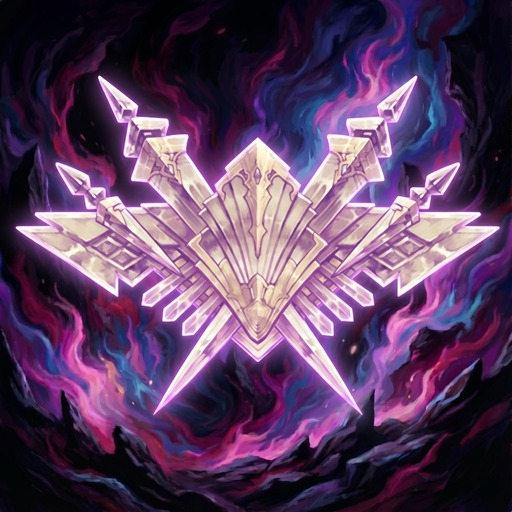
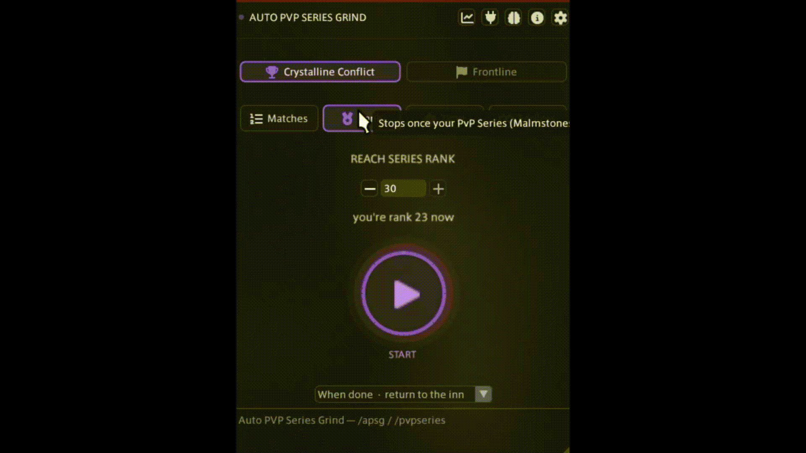

<p align="center">
  
</p>

<h1 align="center">Auto PVP Series Grind</h1>

<p align="center">
  <a href="https://discord.gg/hppkAvdBEE"></a>
  <a href="https://github.com/XeldarAlz/FFXIV-AutoPVPSeriesGrind/releases/latest"></a>
  <a href="https://github.com/XeldarAlz/FFXIV-AutoPVPSeriesGrind/releases"></a>
  <a href="https://github.com/XeldarAlz/FFXIV-AutoPVPSeriesGrind/actions/workflows/release.yml"></a>
  <a href="LICENSE.md"></a>
</p>

<p align="center">
  <em>PvP Series, grinded for you. Built on Dalamud.</em>
</p>

---

<p align="center">
  
</p>

## What it does

Grinds the **PvP Series Malmstones** by looping Crystalline Conflict Casual or Ranked Matches, the daily Frontline roulette, or Hidden Gorge in Rival Wings. Press **Start** and the plugin queues, rides out each match, runs your job's PvP rotation, fires the Limit Break, sends a quick greeting, leaves after confirmed completion, and requeues until it reaches the goal you set: a match count, a Series rank, a time box, or endless.

## Features

- **Visible mode selection**: three cards for Crystalline Conflict, Frontline, and Rival Wings. CC has an explicit Casual / Ranked selector; existing configurations default to Casual. The chosen queue is captured for the run and used for both registration and queue ownership checks. A compact plan strip shows the session goal and after-run action; click either to edit it. Endless mode disables after-run actions without clearing your saved choice.
- **Combat setup on the grind screen**: Defensive, Moderate, Aggressive, and Customize cards. Custom parameters open inline with explanations; switching presets preserves your saved custom values. Frontline and Rival Wings share a profile, clearly labeled in the UI.
- **Direct settings access**: “All combat settings” opens the Combat tab. Full-width settings, wrapping cards, and stacked parameter rows accommodate smaller windows and larger text. Run-bound combat settings are locked during a session; manual movement remains adjustable live.
- **Match loop**: queue → fight → leave → requeue, with explicit handling for Crystalline Conflict, Frontline, and Hidden Gorge.
- **Rival Wings infantry support (preview)**: queues Hidden Gorge, waits for the match to start, follows allied groups, retreats and mounts, and joins NPC objectives allies are attacking. Uses the built-in job rotations. Mech piloting remains manual; this version does not implement train, mercenary, ceruleum, or lane strategy. Queueing, match-start detection, and results handling still need in-game validation.
- **Frontline mode**: queues the daily Frontline roulette on every arena, mounts and waits in place until the gates open, then sticks with the team, holding a role-appropriate spot in the group, falling back when hurt, mounting up for long rides, and hitting the objective the team is attacking, like the ice on Fields of Glory.
- **Human-like play**: every match rolls its own play style (reaction speed, route, spot in the group, gate timing, mount habits, the odd hop), so several copies in one match never move in lockstep. It hops small ledges instead of walking around them and gives up on spots it cannot reach instead of running into walls.
- **Steer yourself**: turn on manual movement and the plugin keeps picking targets, running the rotation and firing the Limit Break while you move. Flip it any time, even mid-match, from Settings or with `/apsg steer` (macro it to a hotbar for a one-key toggle).
- **Built-in PvP rotation**: presses your job's PvP skills, Guard, Purify, Recuperate and Elixir itself; the defensive thresholds are adjustable under Settings, Combat. Switch it to Manual there if you would rather press your own skills.
- **Goals**: run N matches, reach a Series rank, run for a set time, or go endless until you press Stop.
- **Two ways to stop**: **Stop** ends the run at once; **Finish, then stop** lets the match in progress play out first, so nobody gets abandoned.
- **Spawn-aware movement**: leaves the spawn pen toward the right side and contests the objective, holding the point when it's contested instead of re-pathing.
- **Auto Limit Break**: fires the correct PvP LB for your job in any PvP match, run or not, from tuned per-job presets you can edit under Settings, Limit Break, along with skip filters, allowed duties, a name blocklist and an optional fire sound. It replaces the old Auto PVP LB plugin and copies its settings on first load.
- **Social touches**: optional `Hello` during portraits and `Good Match` on results.
- **Run history**: matches, deaths, and time tracked per session.
- **After the run**: stay where you are, return to the inn via Lifestream, log out, or close the game.
- **Verified queueing and completion**: submits only from a known idle queue, verifies registration with bounded retries, and counts each confirmed completion once. Departing without completion evidence stops the run without counting that match. Unrelated queues are left alone.
- **Navigation cleanup**: cancels pending pathfinding on stop, reset, timeout or a major destination change; observes late task failures. Older vnavmesh providers fall back to the original API, where abandoned results are discarded but the provider's work cannot be cancelled.
- **Target protection**: skips untargetable and invulnerable enemies; optional Chiten avoidance also covers chasing and offensive actions. Guard remains a scoring penalty so Guard-breaking actions can still be used.
- **Regrouping**: supplements visible allies with party/alliance roster positions for navigation, without treating roster-only actors as combat or healing targets.

## Validation

Build with `dotnet build AutoPvpSeriesGrind.sln -c Release` and run policy regressions with `dotnet test AutoPvpSeriesGrind.sln -c Release`. The tests exercise queue transitions/timeouts, pre-match mounting and waiting for duty start, completion deduplication, cancellation, target eligibility, mode separation (including Casual versus Ranked queue ownership), and roster-only regrouping without loading Dalamud.

For Frontline, verify that the character mounts once ready and stays still through the pre-match countdown, then follows the team when the gates open. Also check starting the plugin in an already active match and manual movement, which leaves mounting to the player.

Before enabling unattended Rival Wings runs, validate one Hidden Gorge match: registration, pre-match hold, team movement after spawn and respawn, infantry attacks, manual mech control, completion/results detection, and exit. Also verify Stop while pathfinding, Finish-then-stop during registration, and CC/Frontline regression behavior. Automated tests do not verify native game calls or match performance. Also validate CC Ranked registration and acceptance in-game, then Casual and Frontline requeueing. Queue IDs are the game-data ContentRoulette rows [40 (Casual)](https://v2.xivapi.com/api/sheet/ContentRoulette/40?fields=Name) and [41 (Ranked)](https://v2.xivapi.com/api/sheet/ContentRoulette/41?fields=Name).

For UI validation, check all three mode cards, Casual / Ranked persistence after reload, the Custom editor in both Grind and Settings, preset switching without losing custom values, live manual movement during a run, the compact goal and after-run editors (including Endless mode and narrow windows), and the pinned Start/Stop dock. Check the 620px minimum expanded width and higher Dalamud UI/font scales. New setup copy is included in all nine language catalogs.

## Install

In-game: `/xlsettings` → **Experimental** → paste into **Custom Plugin Repositories**:

```
https://raw.githubusercontent.com/XeldarAlz/DalamudPlugins/main/repo.json
```

Tick **Enabled**, click **+**, then **Save and Close**. Open `/xlplugins` → **All Plugins**, search for **Auto PVP Series Grind**, and install.

One helper plugin is required: [vnavmesh](https://github.com/awgil/ffxiv_navmesh) for movement. [Lifestream](https://github.com/NightmareXIV/Lifestream) is optional and only used by the return-to-the-inn after-run action. Combat and the Limit Break need nothing extra; if you still have Auto PVP LB installed, disable or uninstall it, since this plugin now fires the Limit Break itself. Open `/apsg deps` after install to see the list and one-click each missing one.

Rotation Solver Reborn (RSR) must be disabled in Dalamud before automation can run. Its repository can stay enabled. The home page offers **Disable RSR** and shows **Disable RSR to continue** on the blocked Start button. Loading RSR during a run stops automation; shopping and automatic limit breaks are also guarded. A disable request only clears the block once Dalamud reports RSR unloaded. If the button cannot disable it, use `/xlplugins` or manage its collections.

Validate this in-game with RSR loaded at startup, enabled during a run, and disabled again with its repository still enabled. Also check automatic limit breaks while idle, Shop now, multiple Dalamud collections, and the warning at the minimum window width and larger UI scales. The automated tests cover detection, state changes, failed reads, and command validation; they do not exercise Dalamud's unload operation or render the game UI.

## Commands

| Command | Action |
|---|---|
| `/apsg` | Toggle the main window |
| `/pvpseries` | Alias for `/apsg` |
| `/apsg start` | Start a run with the current plan |
| `/apsg stop` | Stop the run now (leaves a queue the run made) |
| `/apsg finish` | Finish the current match, then stop (run again to cancel) |
| `/apsg status` | Print the run's progress, or why it cannot start, to chat |
| `/apsg config` | Open settings |
| `/apsg deps` | Open dependencies window (alias: `dependencies`) |
| `/apsg about` | Open credits / links |
| `/apsg stats` | Open run history (alias: `history`) |
| `/apsg log` | Open the console |
| `/apsg changelog` | Open the changelog |
| `/apsg reset` | Bring the window back on screen at its default size |
| `/apsg target` | Log targeted object's BaseId (debug helper) |
| `/apsg objects` | Log the objective object IDs on the current map (debug helper) |

## Languages

The windows are available in English, Deutsch, Français, Español, Português (Brasil), Русский, Türkçe, 日本語, and 中文. The plugin picks a language from your Dalamud and game client settings on first launch; change it any time under Settings, Session, Language. Game data such as job and map names always follows the game client.

Spotted a wrong or awkward translation? Open a [translation issue](https://github.com/XeldarAlz/FFXIV-AutoPVPSeriesGrind/issues/new?template=translation_report.yml) and tell me what it should say instead.

## Community

Questions, ideas, or just want to hang out with other players? Come say hi on Discord.

→ [Join our Discord](https://discord.gg/hppkAvdBEE)

## More from me

If you liked this plugin, take a look at my other Dalamud work. You might find something else there for you.

→ [XeldarAlz Dalamud Plugins](https://github.com/XeldarAlz/DalamudPlugins)

## License

AGPL-3.0-or-later. See [LICENSE.md](LICENSE.md). [NOTICE](NOTICE) adds the attribution terms the AGPL allows: a fork, or any project that reuses this code, must credit the original author and must not pass itself off as the original. The license covers the code, not the name or the icon: read the [trademark and naming policy](TRADEMARK.md) before you publish a fork.

How AI is used to build this plugin is written down in [AI usage](AI-USAGE.md).
